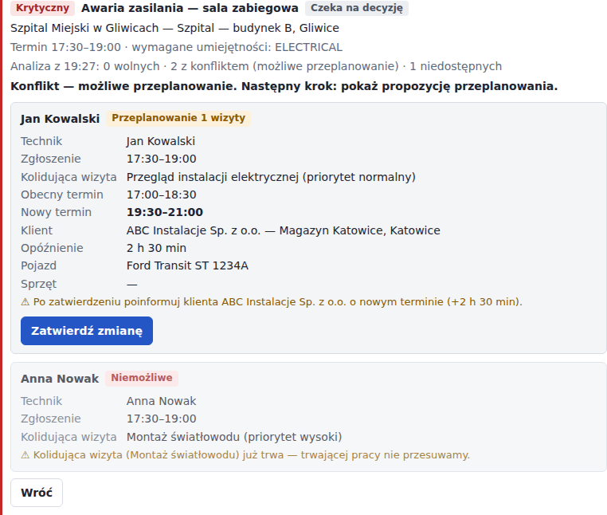
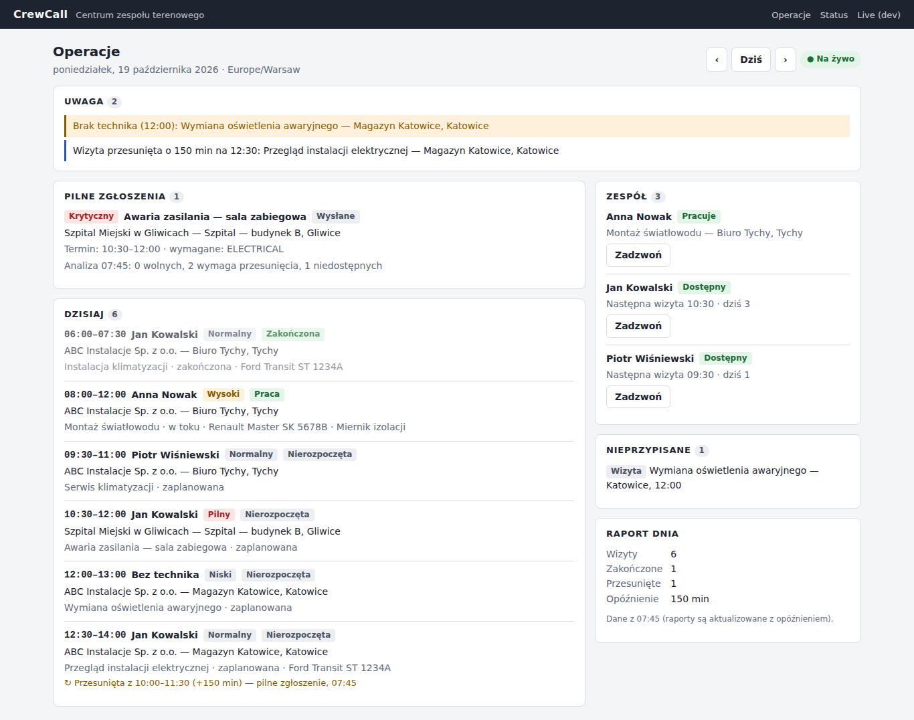
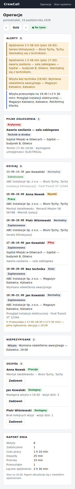

# CrewCall

**CrewCall helps field-service managers coordinate technicians, vehicles, equipment and urgent incidents in one operational view.**

A manager opens one screen and sees today's plan, what every technician is doing right now, the customers and sites,
vehicles and equipment, conflicts, urgent incidents, delays and unassigned work, and can react to a change in a few
clicks. The web app works on a desktop and on a phone.



## The main scenario

The company has a planned day. Then an urgent incident arrives: a hospital has lost power. The times below are from the
seeded demo day, whose plan follows the time you start it.

1. **Urgent incident.** The incident (Critical, needs an electrician, 10:30–12:00) appears on `/operations` live.
2. **Analyze.** CrewCall finds the technicians and checks their skills, plan, availability, vehicle and equipment.
3. **Conflict.** Both electricians are busy: Anna is mid-job, and Jan has a routine inspection at 10:00–11:30.
4. **Proposal.** Send Jan, and move his lower-priority inspection to the first free slot after the incident:
   12:30–14:00, +150 min, with one customer to inform. Work of equal or higher priority, or work already started, is
   never moved.
5. **Manager decision.** Nothing changes until the manager clicks **Akceptuj** (Accept).
6. **Atomic apply.** CrewCall re-checks everything. In one transaction it moves the inspection (same visit, same
   assignment, its reservations moved) and dispatches the incident. A stale proposal is refused with 409 and nothing
   is written.
7. **Everywhere at once.**
   - The calendar shows the new plan.
   - Every open screen refreshes live.
   - The visit's history records why it moved (`VisitRescheduled`, reason `UrgentIncident`).
   - The day's report counts one rescheduled visit and 150 minutes of delay.

| After the decision | On a phone |
|---|---|
|  |  |

## Run it locally

Requirements:

- the .NET 10 SDK;
- Docker, running, for PostgreSQL and RabbitMQ.

```bash
dotnet run --project src/CrewCall.AppHost
```

Aspire starts PostgreSQL, RabbitMQ, the API, Integrations, Reporting and the Web app. Open the **crewcall-web** link
from the Aspire dashboard and go to `/operations`.

The API applies its migrations and seeds an idempotent **demo day** on startup: 3 technicians, 2 customers, 3 sites,
2 vehicles and equipment. The plan includes completed work, work in progress, an unassigned visit and the urgent
incident that causes the conflict. The day is created once per day and anchored on the current time. On another day,
click **Przygotuj dane demo** (prepare demo data) or call `POST /api/demo/seed`.

The demo needs no Swagger, SQL or RabbitMQ UI. The OpenAPI document (`/openapi/v1.json` on the API), the Aspire
dashboard and `/live` (the raw live message feed) are developer tools.

## Architecture

```
                  CrewCall Web
                       |
                       v
                  CrewCall API
                       |
        +--------------+--------------+
        |              |              |
   WorkOrders      Scheduling      Workforce
        |              |              |
        +--------------+--------------+
                       |
                   Resources
                       |
                       v
                   PostgreSQL
                       |
                     Outbox
                       |
                    RabbitMQ
                    /       \
                   v         v
               SignalR    Reporting
```

- **One modular API** owns the business:
  - **WorkOrders**: customers, sites, work orders, visits, incidents, field work;
  - **Workforce**: technicians, skills, working hours, absences;
  - **Resources**: vehicles, equipment;
  - **Scheduling**: checks, matching, assignments, reservations, rescheduling.
  - The scheduling decisions themselves are pure F# (`CrewCall.Scheduling.Core`).
- **PostgreSQL protects the data:**
  - row versions decide concurrent writes;
  - an exclusion constraint makes double-booking a resource impossible;
  - every change writes its history and its integration events in the same transaction (a transactional outbox).
- **Infrastructure stays at the edge:**
  - `CrewCall.Integrations` publishes the outbox to RabbitMQ and pushes small change hints to browsers over SignalR;
  - `CrewCall.Reporting` keeps its own read projections for the reports.
  - The API never waits for either.

The design decisions are recorded as ADRs in [`docs/architecture`](docs/architecture). ADR-0017 covers dynamic
rescheduling and the product-first simplification.

## Technology

- .NET 10, ASP.NET Core, Blazor (interactive server)
- C# for I/O and orchestration, F# for scheduling decisions
- Entity Framework Core 10 with PostgreSQL (Npgsql), NodaTime for time zones
- RabbitMQ (transactional outbox, per-consumer inbox) and SignalR
- .NET Aspire for local orchestration and service discovery

## Tests

```bash
dotnet test --solution CrewCall.sln
```

The tests use Testcontainers (real PostgreSQL and RabbitMQ), so Docker must be running. They cover the business flow end
to end:

- direct urgent assignment;
- a conflict and its reschedule proposal;
- the priority rule;
- a proposal writes nothing;
- a stale proposal returns 409;
- two concurrent accepts give one success and one 409;
- the calendar, the live update, the history and the report;
- the whole demo, from the seeded day to the report, across the API, Integrations, Reporting and a SignalR client.
