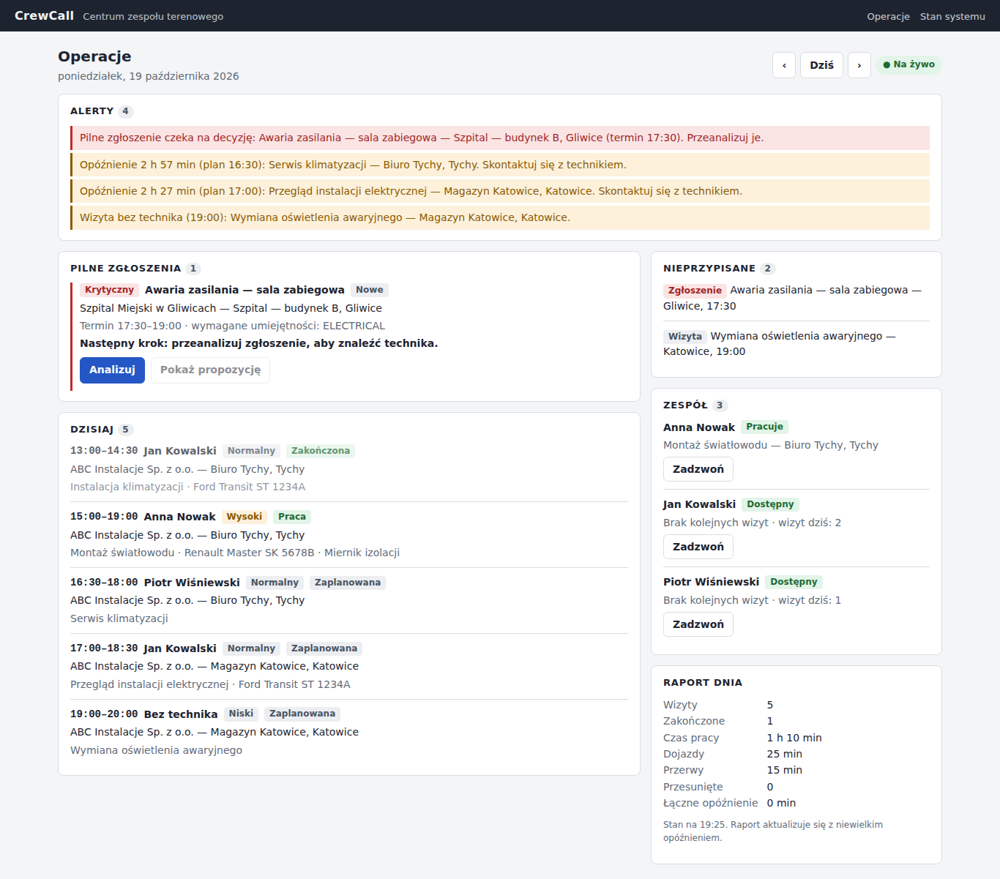
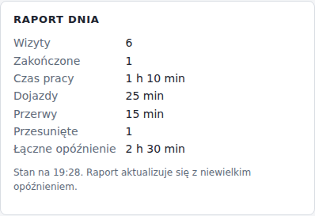
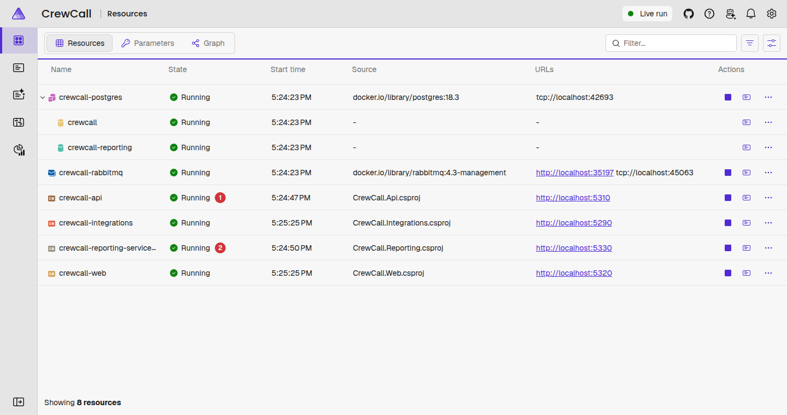

# CrewCall

**CrewCall is a field-operations coordination system for managers who need to plan technicians, vehicles and equipment,
react to urgent incidents, reschedule work and keep the whole team updated from one web interface.**


## 1. What is CrewCall

CrewCall is one web screen for the person who runs a field team for the day. On `/operations` the manager sees:

- **today's plan**: every visit, its technician, vehicle and equipment, and what is happening on site now;
- **urgent incidents**: what came in and what to do next;
- **unassigned work**;
- **the team**: who is free, travelling, working or on a break, with a call button;
- **alerts**: what needs a decision;
- **the day's report**: completed visits, work, travel and break time, reschedules and delay.

The screen works on a desktop, a tablet and a phone, and it updates live when anything changes.

## 2. The problem it solves

A field-service day never goes to plan. A customer reports a failure, every qualified technician is already booked,
and the manager has a few minutes to decide who goes and what moves. Usually that means phone calls, a spreadsheet
and guesswork:

- Who is free?
- Who has the right skills, vehicle and equipment?
- What can be moved without breaking something more important?
- Who has to be told?

CrewCall answers these from the real plan. It proposes one concrete change, shows its cost before anything happens,
and applies it only when the manager approves.

## 3. The main business scenario

The company has a planned day. Then an urgent incident arrives: a hospital has lost power.

1. **Urgent incident.** The incident (Critical, needs an electrician) appears on `/operations`.
2. **Analyze.** CrewCall checks every technician: skills, plan, availability, vehicle and equipment.
3. **Conflict.** Both electricians are busy. Anna is mid-job, and Jan has a routine inspection at the same time.
4. **Proposal.** Send Jan, and move his lower-priority inspection to the first free slot after the incident (+150 min,
   one customer to inform). Work of equal or higher priority, or work already under way, is never moved.
5. **Manager decision.** Nothing changes until the manager clicks **Zatwierdź zmianę** (approve the change).
6. **Atomic apply.** CrewCall checks everything again. In one transaction it moves the inspection (same visit, same
   assignment, reservations moved with it) and dispatches the incident. A proposal that is out of date is refused, and
   nothing is written.
7. **Everywhere at once.**
   - The calendar shows the new plan.
   - Every open screen refreshes live.
   - The visit's history records why it moved.
   - The day's report counts one rescheduled visit and 150 minutes of delay.

## 4. Demo flow

The demo day is seeded on startup and follows the time you start it. The visits are anchored on "now", kept between
09:00 and 16:00 Warsaw time.

1. Run `dotnet run --project src/CrewCall.AppHost` and wait until every resource in the Aspire dashboard is *Running*
   and *Healthy*.
2. Open the **crewcall-web** endpoint from the dashboard. It opens `/operations`, and the live indicator shows
   **● Na żywo** (live).
3. **Dzisiaj** (today) shows the plan:
   - one completed visit;
   - Anna's fibre installation in progress;
   - Jan's inspection and Piotr's air-conditioning service, both planned;
   - one visit with no technician.
4. **Alerty** (alerts) shows *Pilne zgłoszenie czeka na decyzję* (an urgent incident is waiting for a decision).
   **Pilne zgłoszenia** (urgent incidents) shows *Awaria zasilania — sala zabiegowa* with the next step to take.
5. Click **Analizuj** (analyze). CrewCall recommends Jan: *konflikt — możliwe przeplanowanie* (a conflict, rescheduling
   possible). The alert changes to *Konflikt — możliwe przeplanowanie*.
6. Click **Pokaż propozycję** (show proposal). The proposal shows:
   - the technician;
   - the incident's time;
   - the conflicting visit and its priority;
   - its current and new time, and the delay;
   - the affected customer and site;
   - its vehicle and equipment;
   - a reminder to inform the customer.
7. Anna's and Piotr's variants are listed as **Niemożliwe** (not possible), with the reason: their work is already
   under way.
8. Click **Zatwierdź zmianę** (approve the change). The confirmation says where the inspection moved.
9. **Dzisiaj** now shows the incident visit for Jan and the inspection at its new time, marked
   *↻ Przesunięta z … — pilne zgłoszenie* (moved from … because of an urgent incident).
10. Open the page in a second window or on a phone: it changed too, without a reload.
11. **Raport dnia** (the day's report) shows:
    - completed visits;
    - work, travel and break time;
    - one rescheduled visit and 2 h 30 min of total delay.
12. Tap **Zadzwoń** (call) next to a technician: the phone dials them (a `tel:` link).

Approving the same proposal twice is refused ("To zgłoszenie zostało już przydzielone": the incident has already been
assigned). If the plan changed since the proposal, the screen asks for a fresh proposal.

## 5. Architecture

```
                  CrewCall Web
                       |
                       v
                  CrewCall API
                       |
        +--------------+--------------+
        |              |              |
   WorkOrders      Scheduling      Workforce
        |              |              |
        +--------------+--------------+
                       |
                   Resources
                       |
                       v
                   PostgreSQL
                       |
                     Outbox
                       |
                    RabbitMQ
                    /       \
                   v         v
               SignalR    Reporting
```

- **One modular API owns the business:**
  - **WorkOrders**: customers, sites, work orders, visits, incidents and field work;
  - **Workforce**: technicians, skills, working hours and absences;
  - **Resources**: vehicles and equipment;
  - **Scheduling**: checks, matching, assignments, reservations and rescheduling;
  - the scheduling decisions themselves are pure F# (`CrewCall.Scheduling.Core`).
- **PostgreSQL protects the data:**
  - row versions decide concurrent writes;
  - an exclusion constraint makes double-booking a resource impossible;
  - every change writes its history and its integration events in the same transaction (a transactional outbox).
- **Infrastructure stays at the edge:**
  - `CrewCall.Integrations` publishes the outbox to RabbitMQ and pushes small change hints to browsers over SignalR;
  - `CrewCall.Reporting` keeps its own database of read projections for the reports;
  - the API never waits for either.

The design decisions are recorded as ADRs in [`docs/architecture`](docs/architecture).

## 6. Technology

- .NET 10, ASP.NET Core, Blazor (interactive server)
- C# for I/O and orchestration, F# for scheduling decisions
- Entity Framework Core 10 with PostgreSQL (Npgsql), and NodaTime for time zones
- RabbitMQ (transactional outbox, per-consumer inbox) and SignalR
- .NET Aspire for local orchestration, service discovery, health checks and telemetry
- xUnit v3 and Testcontainers (real PostgreSQL and RabbitMQ in the tests)

## 7. How to run locally

Requirements:

- [.NET 10 SDK](https://dotnet.microsoft.com/download);
- [Docker Desktop](https://www.docker.com/products/docker-desktop/), running. Aspire starts PostgreSQL and RabbitMQ in
  containers.

```bash
dotnet run --project src/CrewCall.AppHost
```

What happens:

1. The console prints the **Aspire dashboard** address with a one-time login link
   (`Login to the dashboard at https://localhost:17208/login?t=…`). Open it.
2. Aspire starts six resources:

   | Resource | What it is |
   |---|---|
   | `crewcall-postgres` | PostgreSQL, with the `crewcall` and `crewcall_reporting` databases |
   | `crewcall-rabbitmq` | RabbitMQ |
   | `crewcall-api` | the API |
   | `crewcall-integrations` | the outbox publisher and the live SignalR hub |
   | `crewcall-reporting-service` | the reports |
   | `crewcall-web` | the web app |

   The services wait for what they depend on.
3. The API applies the database migrations, then seeds an idempotent **demo day**:
   - 3 technicians, 2 customers, 3 sites, 2 vehicles and equipment;
   - completed work, work in progress, an unassigned visit, and the urgent incident that causes the conflict.

   The day is created once per day. Restarting changes nothing.
4. A correct start is every resource *Running* with a green health state. Click the **crewcall-web** endpoint: it
   opens on `/operations`.

The PostgreSQL data lives in a Docker volume, so it survives restarts. On a new day, a new demo day is created at the
next start, or with the **Przygotuj dane demo** (prepare demo data) button on an empty day.

Developer tools, which the demo does not need:

- the Aspire dashboard (logs, traces, metrics);
- the OpenAPI document at `/openapi/v1.json` on the API;
- `/status` (component health) and `/live` (the raw live message feed) in the web app.

Run the tests (Docker must be running):

```bash
dotnet test --solution CrewCall.sln
```

## 8. Screenshots

| | |
|---|---|
| **The operations dashboard**: alerts, an urgent incident and the plan of the day |  |
| **The reschedule proposal**: who goes, what moves, the delay, who to inform |  |
| **The plan after approval**: the moved visit says why it moved |  |
| **The day's report** |  |
| **On a phone** (390 px) |  |
| **The Aspire runtime**: all six resources running and healthy |  |

## 9. Key engineering decisions

- **A modular monolith, not microservices, for the business.**
  - One API and one transaction can move a visit and dispatch an incident together.
  - Module boundaries are enforced by project references and per-module schemas (ADR-0001, ADR-0004).
  - Only the parts with a different job (publishing, live updates, reporting) run as separate services.
- **Pure F# for decisions.**
  - Availability, matching, scoring and rescheduling are pure functions in `CrewCall.Scheduling.Core`, with no I/O.
  - C# loads the data, calls them and saves the result (ADR-0002).
- **The database is the last line of defence.**
  - Optimistic concurrency (row versions) settles concurrent writes.
  - A PostgreSQL exclusion constraint makes a double-booked technician, vehicle or piece of equipment impossible, even
    under a race (ADR-0009).
- **Propose, then apply.**
  - A reschedule proposal writes nothing.
  - Applying it checks everything again and is atomic.
  - A proposal that went out of date is refused with 409 (ADR-0017).
- **Transactional outbox and inbox.**
  - Integration events are written in the same transaction as the change.
  - They are published at least once; consumers deduplicate with their own inbox (ADR-0014).
- **Live updates are hints, not state.**
  - A SignalR message only says "this changed".
  - The screen reads the board again from the API, so it can never show a state the API does not have (ADR-0015).
- **Reporting owns its own data.**
  - Projections are built from events into a separate database.
  - The report is eventually consistent and never touches the operational database (ADR-0016).

### Engineering highlights

- An end-to-end demo test runs the whole scenario on a fixed clock: seeded day → board → analyze → proposal → approve
  → calendar → history.
- Concurrency tests: two simultaneous approvals give exactly one success and one 409.
- Every integration test runs against real PostgreSQL 18 and RabbitMQ 4 in Testcontainers. Nothing is an in-memory
  fake.
- Time zones are explicit everywhere (NodaTime, IANA ids). Daylight-saving days are tested.
- The build treats warnings as errors and has central package management. The package vulnerability audit is clean.

## 10. Known limitations

- **Single-level rescheduling.** CrewCall moves at most one lower-priority visit, to the technician's next free slot.
  It does not cascade moves through the rest of the plan.
- **The demo day follows the clock.** The plan is anchored between 09:00 and 16:00 Warsaw time. Started in the
  evening, the day's visits are already in the past, and the board shows them as late.
- **Authentication is out of scope.** There are no users or roles yet. The API and the web app are open to anyone who
  can reach them.
- **Development-only conveniences:**
  - migrations run at API startup only in the Development environment;
  - demo data is enabled only by the AppHost.

  A shared environment needs an explicit migration step and real secrets (see the
  [release checklist](docs/portfolio-release-checklist.md)).
- **Error logs on the very first start.** On a new database, EF Core logs one failed query of the not-yet-created
  `__EFMigrationsHistory` table per service, and Reporting's database health check can time out once while its
  migrations run. These logs show as red badges in the dashboard. They do not repeat on later starts.
- **The report is eventually consistent.** It can be a few seconds behind the plan, and the screen says so.
- **Polish only.** The interface is in Polish, for a Polish field-service company.

## Troubleshooting

- **Docker is not running.** `crewcall-postgres` and `crewcall-rabbitmq` stay in *Waiting* or fail with a container
  runtime error. Start Docker Desktop and run the AppHost again.
- **A resource keeps waiting.** Each service waits for what it depends on:
  - the API waits for PostgreSQL;
  - Integrations waits for the API and RabbitMQ;
  - the web app waits for the API.

  The first start pulls the container images, which can take a few minutes. Look at the waiting resource's logs in
  the dashboard.
- **A port is in use.** The dashboard uses ports 15288/17208 (see
  `src/CrewCall.AppHost/Properties/launchSettings.json`). Stop the other process, or change the ports there. The
  services themselves get free ports from Aspire.
- **The HTTPS development certificate is not trusted.** Run `dotnet dev-certs https --trust`. Alternatively, start the
  http profile with `ASPIRE_ALLOW_UNSECURED_TRANSPORT=true dotnet run --project src/CrewCall.AppHost --launch-profile http`.
- **The screen shows "Nie można połączyć się z serwerem CrewCall"** (cannot connect to the CrewCall server). The API is
  not running or not healthy. Check `crewcall-api` in the dashboard.

## Future work

These are not built, on purpose:

- multi-level (cascading) rescheduling, and a choice between several alternative slots;
- sign-in and roles for managers and technicians, and a technician's mobile view of their own day;
- notifying the affected customer automatically (e-mail);
- travel times from real distances instead of a fixed buffer;
- a deployment pipeline: container images, a migration job, managed PostgreSQL and RabbitMQ;
- English localisation.
